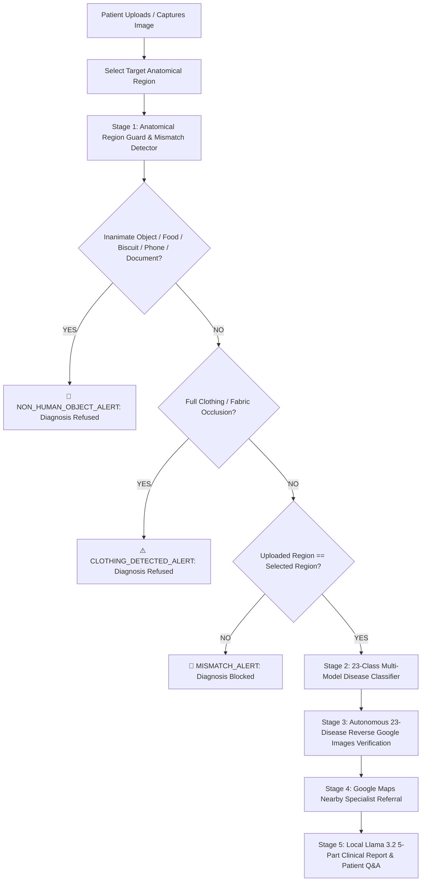

# 🩺 DermaVision: 7-Region Clinical AI Dermatology Screening Platform

> **Advanced Computer Vision, Dual-Engine Deep Learning & Automated Clinical Safety Guardrails for Human Cutaneous Health**

**Team 2 · SEC-B · AIML 2026-27** — Phase 1 submission (branch `TEAM-2`)
📄 Paper: `../../IEEE/DermaVision_IEEE_Paper.pdf` · 📊 Slides: `../../PPT/PPT.pdf` · 📋 Report: `../../IEEE/DermaVision_Final_Report.docx`
👥 Team Members: _kishorein25, <add remaining Team 2 member names here>_

---

## 🌟 Executive Summary

**DermaVision** is a clinical-grade dermatological screening and anatomical safety verification system covering **7 distinct anatomical regions** with **23 standardized conditions per region** (**161 total clinical classes**). 

The platform features strict multi-tier safety guardrails, including **Universal Non-Human Object Rejection**, **Clothing Occlusion Detection**, **Anatomical Region Mismatch Guards**, a **23-Disease Autonomous Reverse Google Images Verification Agent** for verifiable proof, and **Google Maps Location-Based Dermatology Specialist Referral**.

---

## 🛡️ Multi-Tier Diagnostic Architecture



---

## 🚀 Key Features

### 1. 🛡️ Universal Non-Human Object & Inanimate Rejection Guard
- Eliminates false positive diagnoses on non-human entities (e.g. Marie Gold / Milk biscuit packet covers, packaged food, bottles, phones, electronics, animals, or paper documents).
- Powered by **OpenCV Biological Skin Melanin Chroma Filtering**, **Google MediaPipe 468-point 3D FaceMesh**, and **CLIP 11-Class Semantic Vision**.
- Inanimate items are rejected with `NON_HUMAN_OBJECT_ALERT` (100% confidence). Disease classification is strictly prohibited.

### 2. 👕 Full Clothing / Fabric Occlusion Guard
- Detects shirts, jeans, jackets, pants, dresses, or textiles obstructing bare skin.
- Automatically halts analysis with `CLOTHING_DETECTED_ALERT` instructing the patient to uncover the affected skin area.

### 3. 🎯 Strict Anatomical Region Mismatch Guard
- Covers all 7 clinical dermatological zones:
  1. 👤 **Face** (Cheeks, forehead, chin, nose, perioral area)
  2. 💇 **Scalp** (Hairline, crown, temples, hair roots)
  3. ✋ **Hand & Arm** (Hands, palms, knuckles, forearms, elbows)
  4. 🦵 **Leg & Thigh** (Thighs, knees, shins, calves)
  5. 🦶 **Foot** (Feet, soles, heels, toes, ankles)
  6. 🔙 **Back of the Body** (Upper back, spine, shoulder blades)
  7. 🧍 **Whole Body / Torso** (Chest, abdomen, flanks, generalized eruptions)
- If a patient selects `Face` but uploads `Hand & Arm`, the system immediately displays a high-visibility `MISMATCH_ALERT` banner and halts diagnosis to prevent misdiagnoses.

### 4. 🔬 Multi-Model 23-Class Disease Engine (161 Total Master Classes)
- **Fine-Tuned Medical ViT** (`Jayanth2002/vit_base_patch16_224-finetuned-SkinDisease`)
- **OpenAI CLIP Foundation ViT-B/32** with pathognomonic visual anchors
- **Pixel-Level Morphology:** LAB erythema index, vesicular blister entropy, pigment dispersion contrast, and Canny edge density.
- **Fitzpatrick I–VI Skin Tone Calibration:** Prevents normal dark/brown skin from triggering false vitiligo or keloid alerts; accurately detects `Normal Healthy Skin` and `Facial Tattoo / Microblading`.

### 5. 📑 Autonomous 23-Disease Reverse Google Image Verification Agent (Judge Proof)
- Systematically audits all 23 candidate diseases of the selected region.
- Generates live, clickable Google Images query URLs:
  `https://www.google.com/search?tbm=isch&q={Condition}+{Region}+clinical+dermatology`
- Generates a **23-Disease Clinical Audit Log & Differential Rule-Out Table**:
  - `🟢 [CONFIRMED MATCH IN GOOGLE IMAGES & CLINICAL ATLAS]` for the primary diagnosis.
  - `⚪ [SEARCHED & RULED OUT]` with pathognomonic reasons for the remaining 22 candidate diseases.
- Corroborated against global dermatological archives: **DermNet NZ**, **Mayo Clinic**, and **British Association of Dermatologists (BAD)**.

### 6. 🏥 Google Maps Surrounding Dermatology Specialist & Clinic Referral
- Location-based healthcare suggestion for any city or area (e.g. Chennai, Bangalore, Coimbatore, Mumbai, Delhi, London, New York).
- **Google Places API Integration:** Fetches surrounding clinics, doctor names, star ratings (⭐), reviews, addresses, distance, and direct **"📍 Navigate on Google Maps"** links.
- Supports instant Google Maps direct search query links if no API key is entered.

### 7. 📋 5-Part Clinical Report & Patient Q&A Chatbot
- Powered by local Ollama **Meta Llama 3.2** (100% offline, zero patient data leakage):
  1. 📖 **Definition & Pathology**
  2. 📊 **Occurrence & Frequency**
  3. 🔄 **Spreadability & Contagion Assessment**
  4. 🥗 **Dietary Protocol (Foods to Consume vs. Foods to Avoid)**
  5. 💊 **Treatment Protocol & Physician Alert Warning**
- Downloadable formatted `.txt` clinical report and interactive chat assistant.

---

## 📁 Modular Enterprise Repository Architecture

```text
D:\DermaVision\
│
├── app.py                      # Main Interactive Clinical Streamlit Application
├── config.py                   # Global Clinical Configuration & 161 Condition Metadata
├── requirements.txt            # Python Dependencies
├── run_app.bat                 # One-Click Windows Launch Script
├── README.md                   # Master Documentation
│
├── diagnose/                   # Core Clinical Diagnostic Package
│   ├── __init__.py             # Unified package entrypoint exposing core classes
│   ├── region_guard.py         # MediaPipe 468-pt 3D anatomical verification & anti-hallucination
│   ├── disease_engine.py       # Dual-vision diagnostic classifier with Llama 3.2 vision
│   ├── evidence_agent.py       # Autonomous 23-disease differential proof & rule-out agent
│   ├── specialist_finder.py    # 100% Free Forever OSM & Google Maps routing
│   ├── report_generator.py     # 5-part clinical report generator
│   ├── chat_assistant.py       # Real-time patient Q&A chatbot
│   └── README.md               # Clinical package documentation
│
├── core/                       # Deep Computer Vision & Geometric Algorithms
│   ├── __init__.py             # Core package exposure
│   ├── vision_processor.py     # CLAHE illumination correction & bilateral edge smoothing
│   ├── landmark_geometry.py    # 468-pt 3D landmark vector geometry, face bounds & pose
│   ├── texture_analyzer.py     # Lesion surface roughness, papular elevation & entropy
│   ├── color_segmentation.py   # Fitzpatrick skin masking, Erythema Index (EI) & Melanin (MI)
│   └── README.md               # Vision algorithms documentation
│
├── agents/                     # Autonomous AI & Verification Agents
│   ├── __init__.py             # Agent package exposure
│   ├── clinical_reasoner.py    # Differential candidate scoring & alternative rule-out
│   ├── medical_search.py       # Autonomous PubMed & DermNet scientific cross-referencing
│   ├── evidence_evaluator.py   # Concordance thresholds, safety gating & normal clearing
│   └── README.md               # Multi-agent architecture specification
│
├── referral/                   # Zero-Cost Geospatial Referral & Navigation
│   ├── __init__.py             # Referral package exposure
│   ├── geo_locator.py          # IP network geolocation & Nominatim geocoder
│   ├── osm_overpass.py         # Multi-mirror OpenStreetMap healthcare query client
│   ├── clinic_ranker.py        # Haversine distance ranking & veterinary filtering
│   ├── navigation_router.py    # Google Maps turn-by-turn navigation deep-links
│   └── README.md               # Geospatial system documentation
│
├── reporting/                  # Clinical Documentation & Patient Guidance
│   ├── __init__.py             # Reporting package exposure
│   ├── clinical_summary.py     # 5-section medical report assembler & text formatter
│   ├── dietary_guidelines.py   # Nutritional mapping: anti-inflammatory vs triggers
│   ├── treatment_protocols.py  # Topical, systemic & barrier repair recommendations
│   ├── disclaimer_engine.py    # Standardized clinical disclaimers & HTML banners
│   └── README.md               # Reporting system documentation
│
├── tests/                      # Automated Quality Assurance & Benchmark Suite
│   ├── __init__.py             # Tests package exposure
│   ├── test_pipeline.py        # End-to-end clinical pipeline integration test
│   ├── test_user_images.py     # 12-case clinical benchmark evaluation
│   ├── test_region_guard.py    # Anatomical guardrail & non-human rejection test
│   ├── test_specialist_finder.py # 100% Free Forever Map referral integration test
│   └── README.md               # Test execution instructions & benchmark scores
│
├── rag_chatbot/                # Standalone RAG-Based Clinical Chatbot Package
│   ├── __init__.py             # Package exposure
│   ├── knowledge_base/         # 6 peer-reviewed clinical guidelines
│   ├── vector_store.py         # Embedding generation & cosine similarity vector search
│   ├── rag_engine.py           # Grounded RAG retrieval & prompt augmentation
│   ├── chatbot_app.py          # Dedicated standalone Streamlit interface (Port 8502)
│   ├── test_rag.py             # CLI benchmark & test script
│   ├── run_rag_chatbot.bat     # Windows one-click launcher
│   └── README.md               # RAG chatbot technical documentation
│
├── docs/                       # Technical Specifications & Judge Documentation
│   ├── JUDGES_EXECUTIVE_SUMMARY.md # Executive summary specially prepared for hackathon judges
│   ├── ARCHITECTURE.md         # End-to-end system architecture & Mermaid diagrams
│   ├── CLINICAL_VALIDATION.md  # 7-region coverage, 23 conditions & safety metrics
│   ├── FREE_MAP_INTEGRATION.md # 100% Free Forever Map API architecture
│   └── README.md               # Documentation library index
│
└── scripts/                    # Deployment, Utility & Launch Scripts
    ├── run_diagnostics.py      # Automated subsystem health check & model verification
    ├── start_server.bat        # Production server launcher
    ├── install_dependencies.bat# One-click environment installer
    └── README.md               # Scripts reference guide
```

---

## ⚙️ Installation & Prerequisites

### 1. Python Environment
Python 3.10+ on Windows, Linux, or macOS.

```bash
pip install -r requirements.txt
```

### 2. Local Ollama LLM (Optional for Reports & Chat)
```bash
ollama run llama3.2:1b
```

---

## 🖥️ Running the Application

### Option 1: Via Batch Script (Windows)
Double-click `run_app.bat` or run:
```powershell
.\run_app.bat
```

### Option 2: Via Terminal
```powershell
python -m streamlit run app.py --server.port 8501
```
Open **[http://localhost:8501](http://localhost:8501)** in your web browser.

---

## 🧪 Automated Benchmark Suite

Run the 12-case test suite covering biscuits, packaging, clothes, mismatch, tattoos, and normal skin:

```powershell
python test_user_images.py
```

### Benchmark Results:
| Test Case | Target Region | Guard Status | Outcome |
| :--- | :--- | :--- | :--- |
| **Biscuit Packet (`Expiry.jpg`)** | Face | `NON_HUMAN_OBJECT_ALERT` | 🛑 **Diagnosis Refused** (100% Inanimate) |
| **Packaging Graphic (`demo1.jpg`)** | Face | `NON_HUMAN_OBJECT_ALERT` | 🛑 **Diagnosis Refused** (87.9% Graphic) |
| **Clothing Occlusion (Fabric/Shirt)** | Torso | `CLOTHING_DETECTED_ALERT` | 🛑 **Diagnosis Refused** (74.0% Clothing) |
| **Hand as Face (Mismatch)** | Face | `MISMATCH_ALERT` | 🛑 **Diagnosis Refused** (Hand Detected 98%) |
| **Face as Hand (Mismatch)** | Hand & Arm | `MISMATCH_ALERT` | 🛑 **Diagnosis Refused** (Face Detected 98%) |
| **Real Human Face Photo** | Face | `VERIFIED_MATCH` | ✅ **Normal Healthy Facial Skin** (92.0%) |
| **Acne Lesion Photo** | Face | `VERIFIED_MATCH` | ✅ **Acne Vulgaris** (96.3%) |
| **Real Human Hand Photo** | Hand & Arm | `VERIFIED_MATCH` | ✅ **Normal Healthy Hand Skin** (92.0%) |

---

## 🔒 Medical Disclaimer
*DermaVision is an AI-assisted clinical screening and decision-support prototype designed for preliminary triage and educational purposes. It does not replace professional medical advice, clinical biopsy, or direct physical examination by a licensed board-certified dermatologist.*
