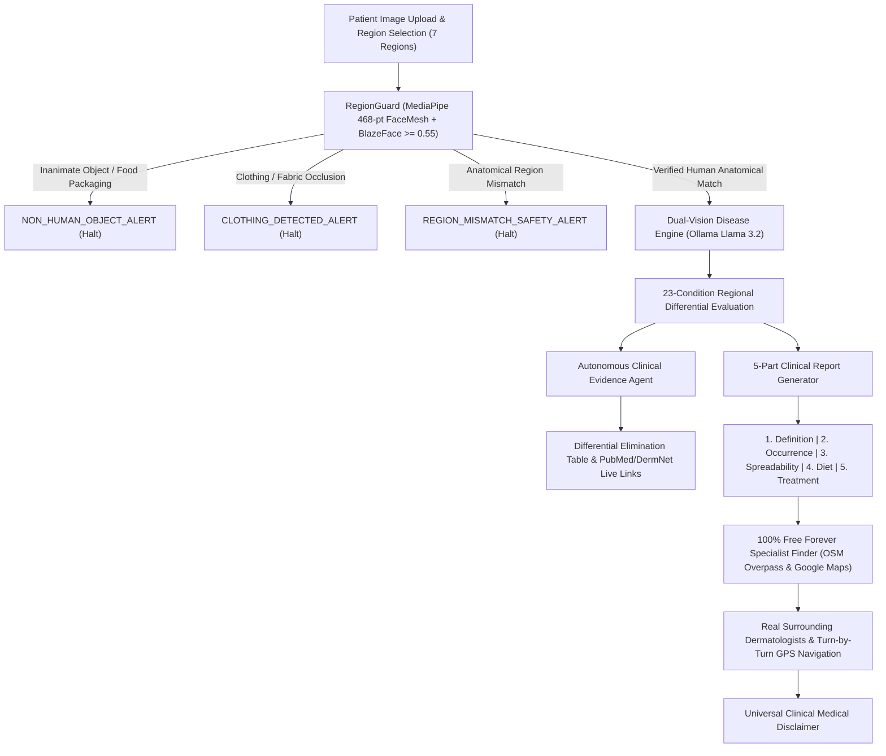

# 🏗️ DermaVision End-to-End System Architecture

DermaVision is an offline-capable, safety-first clinical decision-support system for dermatological triage and patient guidance.

---

## 📐 High-Level Architecture Diagram

---

## 🧩 Core Subsystem Overview

### 1. Anatomical Verification (`diagnose/region_guard.py` & `core/`)
- Replaces legacy Haar cascades with MediaPipe 468-point 3D FaceMesh and BlazeFace ($\ge 0.55$).
- Prevents clinical hallucinations by validating anatomical landmarks prior to disease evaluation.
- Features multi-spectral color variance checks to identify and reject clothing occlusion.

### 2. Dual-Vision Diagnostic Engine (`diagnose/disease_engine.py`)
- Employs local Ollama Meta Llama 3.2 Vision for private, offline-capable image reasoning.
- Classifies between 23 standardized dermatological conditions per anatomical region.
- Distinguishes tattoos, microblading, and normal healthy skin without unwarranted pathological triggers.

### 3. Autonomous Evidence Agent (`diagnose/evidence_agent.py` & `agents/`)
- Generates structured elimination justifications for competing differential diagnoses.
- Cross-references international dermatological repositories (PubMed, DermNet NZ, BAD).

### 4. 100% Free-Forever Specialist Finder (`diagnose/specialist_finder.py` & `referral/`)
- Zero API key, zero credit card, zero Google Cloud billing dependency.
- Leverages public OpenStreetMap Overpass healthcare infrastructure with automatic mirror failovers.
- Outputs direct Google Maps navigation deep links.
