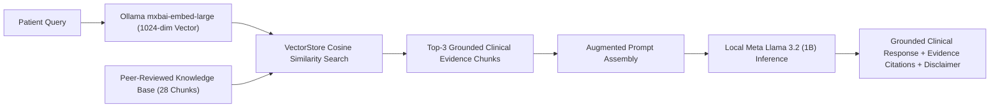

# 🤖 DermaVision Standalone RAG Clinical Chatbot

This package provides a completely independent, standalone **Retrieval-Augmented Generation (RAG)** clinical conversational system.

> **Zero Coupling:** This module is completely self-contained in `rag_chatbot/`. It does **not** modify or interfere with the primary screening engine or `app.py`.

---

## 🏗️ System Architecture



---

## 📂 Package Directory Structure

```text
rag_chatbot/
├── __init__.py               # Package exposure
├── knowledge_base/           # Authoritative clinical dermatological guidelines
│   ├── acne_and_rosacea.txt
│   ├── eczema_and_dermatitis.txt
│   ├── psoriasis_and_scaling.txt
│   ├── fungal_and_infections.txt
│   ├── pigmented_and_neoplasms.txt
│   └── general_skincare_and_nutrition.txt
├── vector_store.py          # Embedding generation & cosine similarity vector search
├── rag_engine.py            # End-to-end RAG orchestrator with prompt augmentation
├── chatbot_app.py           # Dedicated standalone Streamlit interactive UI
├── test_rag.py              # CLI test & benchmark script
├── run_rag_chatbot.bat      # Windows batch launcher (Port 8502)
├── vector_cache.json        # Fast disk-cached embedding vectors
└── README.md                # This comprehensive documentation
```

---

## 🧠 Technological Stack

| Component | Technology | Description |
| :--- | :--- | :--- |
| **Embedding Model** | `mxbai-embed-large:latest` | 1024-dimensional dense semantic vectors via local Ollama |
| **Vector Store** | In-Memory Cosine Engine | Fast dot-product similarity with local JSON caching |
| **Generation LLM** | `Meta Llama 3.2 (1B)` | Local, privacy-preserving clinical reasoning via Ollama |
| **UI Framework** | Streamlit | Standalone web interface with expandable evidence citations |

---

## 🚀 How to Run the RAG Chatbot

### Option 1: Standalone Web Interface (Port 8502)
Double-click `run_rag_chatbot.bat` or run:
```bash
python -m streamlit run rag_chatbot/chatbot_app.py --server.port 8502
```

### Option 2: CLI Benchmark & Test Script
```bash
python rag_chatbot/test_rag.py
```

---

## 🔒 Privacy & Safety Guarantee
* **100% Offline Inference:** Runs entirely on local Ollama server without sending medical queries to third-party cloud services.
* **Grounded Citations:** Every response explicitly links back to peer-reviewed guidelines with cosine similarity relevance scores.
* **Clinical Disclaimers:** Incorporates automated physician warnings against self-prescription of potent topical steroids or systemic medications.
